# Review Response Assistant

Учебный ассистент для обработки отзывов: получает новые записи через HTTP API, определяет тональность, публикует ответ и сохраняет состояние между запусками. Проект подготовлен по материалам PEcb09 и архивам `app_test_2803-main.zip` и `worker_ai-main.zip`.

**Проверенный режим: локальный FastAPI-сайт + SQLite + шаблонный mock ответов.** Реальные вызовы LLM и доставка уведомлений Telegram не тестировались. VPS не использовался; Docker Compose не входит в эту локальную сборку.

## Возможности

- Три класса тональности: `positive`, `negative`, `neutral`.
- Ответы отдельными комментариями с `parent_id` исходного отзыва.
- Перевод исходного отзыва и ответа в статус `processed`.
- Проверка локального JSON-состояния и пропуск собственных сообщений `AI Support`.
- В исходном обработчике предусмотрены OpenAI API и уведомления Telegram; без настроек используются шаблоны и пропускается отправка уведомлений.

Тональность всегда определяется **по ключевым словам**, а не LLM. При пустом `OPENAI_API_KEY` ответы берутся из `build_fallback_response` в `worker/processor.py`: это локальный шаблонный mock, не нейросетевая генерация.

## Быстрая проверка

Требования: Python **3.12**, свободный порт **18009**. Команды выполняются из корня репозитория. Для установки зависимостей требуется интернет; сама проверка использует только локальный адрес.

### Windows / PowerShell

```powershell
git clone https://github.com/andrgol12-sys/review-response-assistant.git
cd review-response-assistant
python -m venv .venv
.\.venv\Scripts\python.exe -m pip install -r requirements-local.txt
Copy-Item .env.example .env
.\.venv\Scripts\python.exe test_pipeline.py
```

### Linux / macOS

```bash
git clone https://github.com/andrgol12-sys/review-response-assistant.git
cd review-response-assistant
python3.12 -m venv .venv
.venv/bin/python -m pip install -r requirements-local.txt
cp .env.example .env
.venv/bin/python test_pipeline.py
```

`test_pipeline.py` запускает настоящий HTTP-сервер, создаёт три отзыва, вызывает исходную функцию обработки и проверяет результаты. В завершение сервер останавливается. Скрипт принудительно очищает ключ OpenAI и настройки Telegram **только в своём процессе**, чтобы не обращаться к внешним сервисам даже при наличии переменных в системе.

Ожидаемый итог:

```text
PASS: 3 tones, 3 replies, processed statuses, repeat poll, state reload and state guard. MOCK; NO LLM.
```

Проверяются совпадение тональности, один непустой ответ на каждый отзыв, статусы `processed`, повторный опрос после перечитывания state file и защита от дубля при искусственном возврате обработанного отзыва в `new`. Каждый запуск добавляет ещё три тестовых отзыва в локальную базу.

Создаются файлы `test_results.json`, `reviews_snapshot.json`, `Таблица_тестирования.csv`, `server.log`, а также база и состояние в `data/`. Они исключены из Git; сохранённые результаты учебного прогона находятся в [docs/evidence](docs/evidence).

## Запуск сайта и фонового обработчика

После установки зависимостей и копирования `.env.example` в `.env` создайте папку `data`. В PowerShell:

```powershell
New-Item -ItemType Directory -Force data
.\.venv\Scripts\python.exe -m uvicorn app.main:app --host 127.0.0.1 --port 18009
```

Откройте [локальный сайт](http://127.0.0.1:18009). В другом терминале **из корня репозитория**:

```powershell
.\.venv\Scripts\python.exe worker/worker.py
```

Для Linux/macOS используйте `mkdir -p data` и `.venv/bin/python` вместо Windows-пути к Python. Оба процесса останавливаются сочетанием `Ctrl+C`. В режиме ручного запуска настройки читаются из корневого `.env`.

## Настройки

| Переменная | Назначение |
| --- | --- |
| `LOCAL_DATABASE_URL` | Локальная SQLite-база; пример уже заполнен |
| `TARGET_SITE_URL` | Адрес сайта, по умолчанию в примере `http://127.0.0.1:18009` |
| `WORKER_API_TOKEN` | Общая строка для авторизации PATCH-запросов сайта и обработчика |
| `WORKER_POLL_INTERVAL` | Интервал опроса в секундах |
| `STATE_FILE_PATH` | Путь к JSON-файлу состояния |
| `AI_AUTHOR_NAME` | Имя автора автоматических ответов |
| `OPENAI_API_KEY` | Пустое значение включает локальные шаблоны |
| `OPENAI_MODEL` | Модель для необязательного реального вызова API |
| `TELEGRAM_BOT_TOKEN`, `TELEGRAM_USER_CHAT_ID` | Необязательная отправка уведомлений |

В примере нет реальных секретов. `.env` исключён из Git. Учебный worker-токен в `.env.example` публичный и подходит только для этой локальной демонстрации. При заполнении ключа OpenAI ручной запуск обработчика будет выполнять реальные платные API-запросы; при ошибке API код переходит к шаблонному ответу. Наличие успешного ответа само по себе не доказывает вызов LLM.

## Путь данных и структура

```mermaid
flowchart LR
    Form[Форма сайта] --> API[app/api/routes.py]
    API --> DB[(SQLite)]
    DB --> Client[worker/client.py]
    Client --> Worker[worker/worker.py]
    Worker --> Tone[processor.py: маркеры тональности]
    Tone --> Notify[telegram_bot.py: опциональное уведомление]
    Notify --> State[state.py: проверка состояния]
    State --> Response[processor.py: шаблон или OpenAI]
    Response --> Reply[client.py: POST ответа и PATCH статусов]
    Reply --> Save[state.py: сохранение ID]
```



| Файл / папка | Роль |
| --- | --- |
| `app/main.py` | FastAPI, инициализация схемы базы |
| `app/api/routes.py` | Страница и GET/POST/PATCH API отзывов |
| `app/models/`, `app/db/` | Модель отзывов, подключение и сессии базы |
| `app/templates/index.html` | Форма и список отзывов |
| `worker/worker.py` | Координация и периодический опрос |
| `worker/client.py` | HTTP-запросы к сайту |
| `worker/processor.py` | Классификация и формирование ответов |
| `worker/state.py` | Состояние обработанных отзывов и уведомлений |
| `worker/telegram_bot.py` | Отправка уведомлений при наличии настроек |
| `test_pipeline.py` | Локальная интеграционная проверка |

Для SQLite добавлен `LOCAL_DATABASE_URL` в `app/config.py`; PostgreSQL-специфичные миграции в `app/main.py` выполняются только для PostgreSQL. Для PostgreSQL потребуется отдельно установить `asyncpg` и настроить сервер базы. Он не нужен для приведённого локального запуска.

## Материалы домашнего задания

- [Обязательная часть: 7 предложений](docs/Обязательная_часть.txt).
- [Отчёт и инструкция в PDF](docs/PEcb09_Отчет_и_инструкция_запуска.pdf).
- [Исходный текст отчёта](docs/Результат_ДЗ.md).
- [Результаты тестов JSON](docs/evidence/test_results.json).
- [Таблица тестирования CSV](docs/evidence/Таблица_тестирования.csv).
- [Снимок ответов API](docs/evidence/reviews_snapshot.json).
- [Отдельная схема Mermaid](docs/Схема_пути_данных.mmd).

Отчёт и PDF описывают первоначальную учебную поставку, где исходные архивы были распакованы в `source/`. В этом репозитории рабочие версии находятся непосредственно в `app/` и `worker/`, результаты - в `docs/evidence/`; дубли исходников и журналы не публикуются.

## Ограничения

Маркеры могут ошибаться на отрицаниях, сарказме и сложных формулировках. Три успешных примера подтверждают работу пайплайна, а не качество классификации произвольных текстов. Шаблон нейтрального ответа универсален и не учитывает конкретные детали.

POST ответа, PATCH статусов и запись JSON не образуют одну транзакцию: при аварии между действиями возможен дубль. Файл состояния не рассчитан на несколько параллельных обработчиков. `mark_processed` записывает ID также в список notified даже при отключённом Telegram, поэтому этот список не является подтверждением доставки. Уведомления в коде предусмотрены для всех новых пользовательских отзывов.

Сайт предназначен для локальной учебной демонстрации: публикация отзывов и чтение API открыты, а проверка worker-токена применяется к PATCH. Публичное размещение требует отдельной доработки доступа и хранения состояния.
